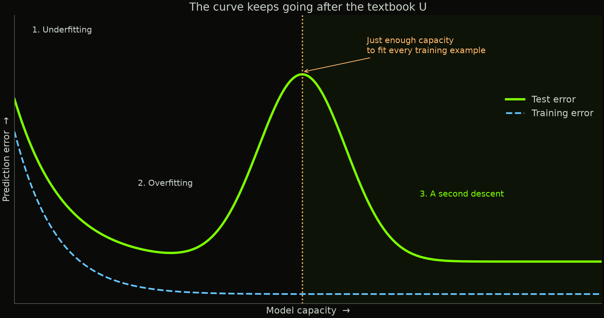
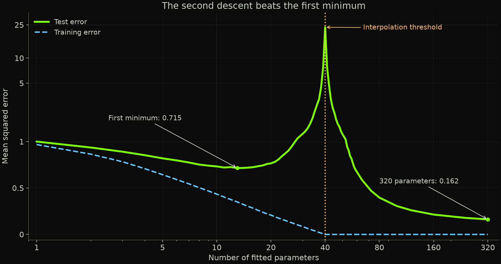
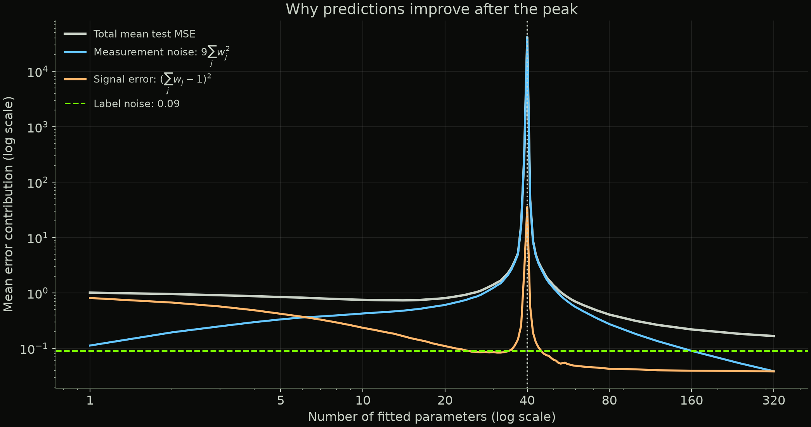

Make a model bigger and its predictions improve. Keep going and they get worse. Keep going *again*, and they improve while training error stays at zero. How did the familiar warning about overfitting leave room for this?

---

Imagine you're teaching a computer to predict something. You give it a simple model, and it misses the pattern. You give it a more flexible model, and it improves. Give it even more flexibility, and it starts chasing the peculiarities of your training examples. Its predictions on new examples get worse.

So far, this is the standard story about overfitting. The reasonable response is to make the model smaller.

But suppose you do the opposite. You make it much, much bigger.

Past the overfitting peak, its predictions start improving again.

That second improvement is **double descent**, and the part I find astonishing is what happens to the training error: it can stay at zero throughout that entire second descent. The model continues fitting every training example perfectly. Its predictions on examples it has never seen improve anyway. [Belkin and colleagues documented this pattern across several model families](https://arxiv.org/abs/1812.11118).

This article takes inspiration from [Welch Labs' double descent video](https://www.youtube.com/watch?v=z64a7USuGX0), which is a great visual introduction to the topic. Their [supporting polynomial experiments](https://github.com/WelchLabs/videos/tree/master/_2025/generalization) are also available. I'll use a different, deliberately simple experiment here: ordinary linear regression. No giant neural network required.

## The curve we learned first

Suppose we want to predict house prices from examples of past sales. **Training error** measures how badly our model predicts those examples. **Test error** measures how badly it predicts a separate set of sales it did not learn from. Doing well on those new examples is called **generalization**.

A model that predicts the same price for every house probably misses some useful information. A model that uses square footage might improve. Add useful relationships with location and condition, and it might improve further.

Eventually, though, a flexible model can start treating accidents as rules. Maybe the training sample happens to contain three expensive houses with purple front doors. Our model decides purple paint is a financial asset. Somewhere, a real estate agent starts ordering paint.

This is **overfitting**: fitting the training sample in ways that hurt prediction on new data. The familiar diagram shows test error falling as flexibility increases, reaching a sweet spot, then rising. Training error keeps falling because the model has more ways to fit what it has already seen.

That diagram gives you a useful instinct: if additional flexibility makes test performance worse, back off.

With double descent, test error starts falling again beyond the peak.

*Schematic only. The axes show qualitative behavior, not measured values. A second descent can sometimes beat the first minimum, but this drawing does not imply that it always does.*

## Why this was such a surprise

Successful deep networks had enough capacity to memorize their training data. Why should those same systems learn useful patterns?

In a [paper first submitted in 2016 and published at ICLR 2017](https://arxiv.org/abs/1611.03530), Chiyuan Zhang and colleagues tested this directly. They replaced the correct image labels with random ones. The networks could still fit the training data. Their experiments also included replacing the images with random noise.

Think about what random labels mean. A particular cat picture might be assigned “airplane,” while another cat picture is assigned “truck.” There is no consistent relationship to discover across independent examples. A network can memorize those assignments, but that gives it no useful rule for predicting fresh, independently randomized labels.

Yet networks trained on meaningful labels could generalize well. The capacity to memorize was present in both cases. Saying “the network is too constrained to memorize” could not explain the difference.

That study did not establish the double descent curve. It showed that the same networks could memorize random labels and generalize when trained on meaningful ones.

Then [Belkin, Hsu, Ma, and Mandal proposed the double descent framing in work first submitted in 2018 and published in 2019](https://arxiv.org/abs/1812.11118). Their picture connected the familiar U-shaped regime with a further regime beyond the point where training examples can be fitted exactly.

The intimidating rise in error could be an intermediate peak. In their random-feature experiments, sufficiently large models could even outperform the model at the first sweet spot, despite fitting the training examples exactly. Stop at the peak, and you would miss what happens next.

This was not the first time anyone had seen related behavior. [Loog and colleagues traced earlier observations and analyses back to work in 1989 and 1990](https://arxiv.org/abs/2004.04328), as well as later studies of classifiers. The modern surprise was a challenge to a widely taught picture of model selection, with evidence spanning several kinds of models. 

A result can exist in the literature and still fail to become common knowledge.

## The dangerous point is “just enough”

To understand the peak, imagine fitting a curve through 40 noisy observations.

With very few adjustable coefficients, the model cannot accommodate every point. As we add coefficients, it gains flexibility. Eventually, it becomes possible to fit all 40 observations exactly.

That boundary is the **interpolation threshold**. Here, “interpolation” means matching the observed targets exactly, including whatever noise they contain.

For the linear regression below, the threshold is at 40 fitted coefficients for 40 scalar observations, assuming the training matrix has full rank. Full rank means that the columns of this square matrix are linearly independent; the input features can still be statistically correlated. We fit no separate intercept, so the coefficients are all the model's adjustable parameters. Neural networks need a more careful account: architecture, data, and training procedure affect where fitting becomes possible. Parameter count alone does not locate every threshold.

Right at the boundary, the model may have very little freedom in *how* it achieves the perfect fit. Some directions in the inputs are barely distinguishable across the training examples. Fitting noise along those directions can require enormous coefficients, which then produce bad predictions on fresh inputs. [Schaeffer and colleagues explain this noise amplification through linear regression](https://arxiv.org/abs/2303.14151).

## Why the fitting rule matters

Beyond the interpolation threshold, there can be many sets of coefficients that fit every training observation exactly. The fitting procedure determines which set we get. Adding parameters can make an exact fit with smaller coefficients possible, even while training error stays at zero.

In the experiment below, we use the **minimum-norm solution**: among the fits that minimize training error, choose the one with the smallest sum of squared coefficients,

$$\sum_{j=1}^{p}w_j^2.$$

Here, $p$ is the number of fitted coefficients and $w_j$ is the weight on input feature $j$. This rule matters once multiple fits achieve the same training error. Fitting the data perfectly does not tell us which of those fits will predict well.

For linear squared-error regression, gradient descent started with all weights at zero and run to convergence with a suitable step size selects this same solution. Its updates are combinations of the training input vectors. Weight components in directions that do not affect the training predictions stay at zero. Adding those components would increase the coefficient norm without improving the fit. That is an example of **implicit regularization**: the training procedure favors a particular fit even without a penalty term in its loss. [The appendix of Double Descent Demystified explains this result](https://arxiv.org/pdf/2303.14151).

Our code computes the minimum-norm solution directly. We do not run gradient descent or add a weight penalty. We use the solution that zero-initialized gradient descent would reach for this linear problem.

But why should smaller coefficients help? That depends on what the inputs contain.

## More room can mean less measurement noise

Suppose we want to predict a quantity we cannot observe directly. Call its true value $z$. Instead, we have several noisy measurements of it, like thermometers that each give a slightly different reading.

For measurement $j$, write:

$$x_j=z+\eta_j,$$

where $\eta_j$ is that measurement's error. In our example, these errors are independent, have mean zero, and each has variance 9. The underlying value $z$ has mean zero and variance 1. The measurements share the same signal, so the $x_j$ values are correlated even though their measurement errors are independent.

If we average $p$ measurements, we get:

$$\frac{x_1+\cdots+x_p}{p}=z+\frac{\eta_1+\cdots+\eta_p}{p}.$$

The signal stays intact. The variance of the measurement noise falls:

$$\operatorname{Var}\left(\frac{\eta_1+\cdots+\eta_p}{p}\right)
=\frac{1}{p^2}\underbrace{(9+\cdots+9)}_{p\text{ independent errors}}
=\frac{9p}{p^2}=\frac9p.$$

With 10 measurements, that variance is $9/10=0.9$. With 100, it is $9/100=0.09$.

We are assigning a weight of $1/p$ to each noisy input. Their weights add to 1, preserving the shared signal, while their squared weights add to $1/p$, reducing the noise in the prediction.

Our regression will learn its own weights rather than use a simple average. It also has to fit noisy training targets. The averaging example shows why small weights can help with these particular inputs; it does not yet explain how a model can fit all the training noise and still predict well.

## Let's actually make the curve

The target we want to predict is the hidden value plus a little additional noise:

$$y=z+\epsilon,$$

where $\epsilon$ has mean zero and variance $0.09$. In the simulation, $z$, all the measurement errors $\eta_j$, and the label noise $\epsilon$ are independent Gaussian variables. A label is the target value supplied during training.

I generate 40 training observations, each with 320 noisy measurements available. Then I fit linear models using the first $p$ measurements: every width from 1 to 60, followed by selected widths up to 320. Within a run, every model gets the same 40 observations and targets. Only the number of available input features changes.

**Each extra feature is another noisy measurement of the same signal.** We are adding information about those same observations, while also adding another coefficient to estimate. We are not giving the wider models additional training observations.

Each model minimizes training squared error, using the minimum-norm solution when there is a choice. I report **mean squared error (MSE)**: square the difference between each prediction and target, then average. I repeat the experiment on 400 independently generated training sets, using a fixed random seed.

*Original experiment across 400 runs. Green shows median test error; dashed blue shows mean training error. Both use the same axes. The horizontal axis is logarithmic; the vertical axis is linear up to an error of 1 and logarithmic above it, keeping zero training error and the full interpolation peak visible.*

The first minimum occurs at 13 parameters in the median curve, with test error about **0.715**. Increasing the number of parameters to 40 produces an enormous peak. But at 80 parameters, test error is already below the first minimum. At 320, it is about **0.162**.

| Fitted parameters | Median test MSE across 400 runs | What's happening |
|---|---:|---|
| 1 | 1.001 | One noisy measurement gives a poor prediction |
| 13 | 0.715 | First minimum in the median curve |
| 20 | 0.766 | Fitting more coefficients starts to hurt |
| 40 | 23.390 | Interpolation peak |
| 80 | 0.397 | Below the first minimum, with zero training error |
| 160 | 0.214 | Further improvement |
| 320 | 0.162 | Best median among the widths tested |

The second descent beats the first minimum here. It also wins if we compare **mean** errors: the best mean below 40 parameters is approximately 0.736, at 14 parameters, while the 320-parameter model averages approximately 0.167. These are averages across our 400 runs, not exact averages over every possible training set.

Beating the first minimum is the especially striking version of double descent. The name describes the fall, rise, and second fall; it does not require the second minimum to be lower in every setup. [Belkin and colleagues show examples where it is lower](https://arxiv.org/abs/1812.11118).

## What makes the second descent work here?

We know the simulation's true data-generating process, so we can calculate the expected error of each fitted model on fresh observations exactly. We do not need a finite test sample to estimate it.

For fitted weights $w_j$, the prediction is:

$$\hat y=\sum_{j=1}^{p}w_jx_j
=\left(\sum_{j=1}^{p}w_j\right)z+\sum_{j=1}^{p}w_j\eta_j.$$

Subtract the true target $y=z+\epsilon$:

$$\hat y-y=\left(\sum_{j=1}^{p}w_j-1\right)z+\sum_{j=1}^{p}w_j\eta_j-\epsilon.$$

For a fresh observation, these three terms are independent and have mean zero, with the fitted weights held fixed. Their variances add. That gives us:

$$\text{Test MSE}
=\underbrace{0.09}_{\text{fresh label noise}}
+\underbrace{\left(\sum_{j=1}^{p}w_j-1\right)^2}_{\text{error in recovering the shared signal}}
+\underbrace{9\sum_{j=1}^{p}w_j^2}_{\text{measurement noise in the prediction}}.$$

The sum of squared weights directly determines the last term. The sum of the weights determines whether we recover the signal at the right scale. Setting all weights to zero would eliminate measurement noise, but it would also throw away the signal.

*Each contribution is averaged across the same 400 fits. The curves add to total mean test MSE. These are contributions from the three independent sources in our simulation, not a formal bias-variance decomposition across training sets. Near the peak, a few very unstable runs make the mean much larger than the median in the previous figure.*

For example, the average contributions at 80 parameters are:

$$\text{Mean test MSE}\approx0.090+0.043+0.274=0.407.$$

At 320 parameters:

$$\text{Mean test MSE}\approx0.090+0.038+0.039=0.167.$$

The large improvement comes from reducing measurement-noise amplification while keeping the shared-signal error small. The fresh label noise is unchanged.

Why does the fitting procedure find those weights? All the measurements contain the same $z$. We can preserve that shared component by distributing weight across many measurements. Once there are more parameters than observations, there are also many ways to reproduce the particular noise in the training targets. The minimum-norm rule selects the fit that does this with the smallest total squared weight. As we add measurements, its minimum possible squared weight cannot increase: the previous fit remains available by setting each new coefficient to zero.

Right around 40 parameters, achieving a perfect training fit can require large weights on combinations of measurements that barely vary across the training sample. Those weights amplify fresh measurement noise. Farther beyond the threshold, additional measurements allow an exact fit with much smaller squared weights, while their shared signal remains useful for predicting new targets.

**The model still fits the training noise. Its prediction becomes less sensitive to fresh measurement noise.** We can measure that distinction directly in the last term of our error equation.

This is a simple instance of the [latent-variable models studied by Hastie and colleagues](https://arxiv.org/html/1903.08560v5#S5.SS4). Their analysis also connects the abundance of noisy features with a ridge-like regularization effect on the hidden signal. Here, the preference for the minimum-norm fit and the structure of the inputs both matter. Extra parameters alone do not guarantee this result.

The [Python script](generate_figures.py) generates all three figures and the [results CSV](experiment-results.csv). The test-error formula is exact for each fitted model under our simulation assumptions. The curves across training sets are empirical results from 400 runs.

## How data and training affect double descent {#the-catch}

**The input structure matters.** Our wider models receive additional noisy measurements of a useful signal. Adding only irrelevant features, or making literal copies of existing ones, would change the experiment. Literal copies supply no independent measurements and do not create new ways to fit 40 arbitrary targets.

**There is no promise of two descents in every experiment.** The data, features, fitting rule, and amount of noise all matter. The bias-variance decomposition for squared-error prediction remains valid; it does not require the error curve to have a single U shape. [Double Descent Demystified](https://arxiv.org/abs/2303.14151) discusses how changing these ingredients can remove the peak.

**The training procedure matters.** Regularization means adding a preference or constraint to discourage certain fits. A penalty on large coefficients can soften the instability in our linear example. Stopping training early can also change the observed curve. [Nakkiran and colleagues' deep learning experiments](https://arxiv.org/abs/1912.02292) found that many of their double descent effects disappeared with optimal early stopping, while some remained.

**This is not confined to changing model size.** That same study observed related behavior as training duration changed, and settings where adding training examples hurt test performance near a critical regime. An epoch is one pass through the training data. Epoch-wise double descent changes that training duration; the experiment above instead changes model width. Keep track of what the horizontal axis means.

**A larger model still needs useful information to generalize.** A second descent does not turn independently randomized labels into a predictable rule. Nor does it establish that every increase in model size is worth its cost.

## Takeaways

- A perfect training fit does not, by itself, tell us whether predictions on new data will be good. Models can interpolate and still improve their generalization.
- The interpolation threshold can be an unusually unstable place. Seeing performance worsen there does not establish that all larger models will perform worse.
- Model size and the behavior of the selected predictor are different things. The fitting procedure's preference among possible solutions helps determine what extra capacity buys us.

What sticks with me is how reasonable it would have been to stop at the peak. You make a model larger, it gets worse, and the familiar theory seems to have warned you correctly. In our experiment, the larger models fit the same training data perfectly and make better predictions.
